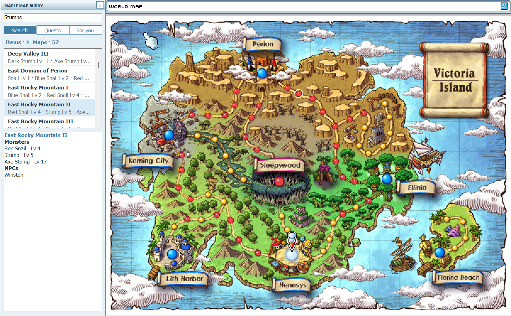
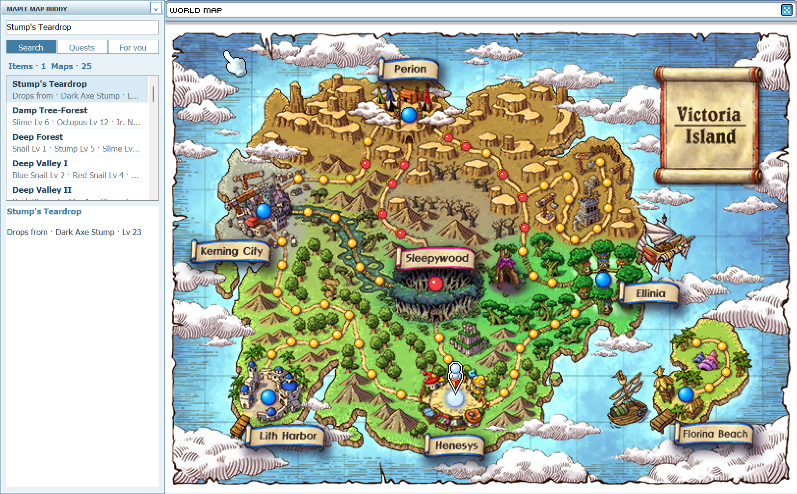

# Maple Map Buddy

Find monsters, NPCs, quest items, and training spots directly on your MapleStory Classic World map. The overlay opens with the world map and hides when you leave the game.

[Download for Windows](https://github.com/GitFist/Maple-Map-Buddy/releases/latest)

[Experimental Mac beta](https://github.com/GitFist/Maple-Map-Buddy/releases/tag/v1.0.0-mac-beta.1) — macOS 14+, Apple silicon and Intel. Not yet tested in-game on a Mac.

Quest item search

**Windows:** extract the ZIP, run **VC_redist.x64.exe** once, then launch **MapleMapBuddy.exe** and open the in-game world map.

**Mac beta:** extract the ZIP, move the app to Applications, then use its menu-bar icon to allow Screen Recording. Setup details are included.

Ready-to-use app. Application source code is not published.
